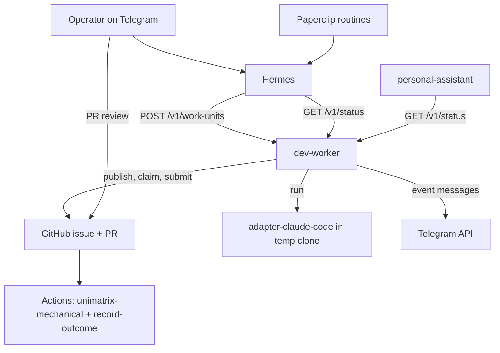

# Helm × Unimatrix: software-development lane (design)

**Date:** 2026-11-13
**Status:** draft; open questions resolved in chat on 2026-11-13; awaiting spec file review before any implementation plan
**Repos touched:** `xbonell/helm` (this spec's home) and `xbonell/unimatrix`

## Goal

Make Helm a single personal "swarm" that covers both personal-assistant work and software-development work on the operator's own projects, by using Unimatrix as the development lane instead of building a second dev workflow inside Helm.

The target experience:

1. Operator sends Hermes a Telegram message such as "in `xbonell/foo`, add retry to the weather client".
2. Helm publishes that as a Unimatrix `WorkUnit` (a GitHub issue) in the target repo.
3. A worker inside the Helm stack claims it, runs a coding agent, and opens a PR.
4. GitHub Actions runs the mechanical checks; the operator reviews and approves the PR.
5. Hermes reports the PR link on Telegram, and the daily brief lists outstanding dev work.

## Context

- Helm today: Paperclip (control plane) → Hermes (runtime) → small FastAPI services. One real capability, the daily brief. The Decider route already offers a `development` candidate that nothing handles. Priorities in the brief are mocked.
- Unimatrix today (M4): protocol `0.1.0`, GitHub Lite provider, local Cursor adapter, CLI with `publish`, `claim`, `run`, `submit`, `claim-run-submit`, `record-outcome`, `doctor`. Every step is typed by a human; there is no daemon, no planner, and the only adapter needs a local Cursor setup.
- The two are complementary: Helm has the always-on runtime, scheduler, chat channel and memory; Unimatrix has the work definition, lease state machine, and validation gates.

## Decisions

| Topic | Choice | Why |
|-------|--------|-----|
| Repository shape | **Two repos, one product.** Helm consumes Unimatrix; no code merge | Python Compose stack vs TypeScript library; Unimatrix's protocol must stay free of runtime dependencies |
| Source of truth for dev work | **GitHub** (Unimatrix Lite: issues, PRs, checks) | Already built and auditable; avoids coupling to Paperclip's data model |
| Paperclip's role | Trigger and report only (routines, issue comments) | Same pattern as the daily brief |
| Where the worker runs | New Compose service **`dev-worker`** (Node 24) | Needs `@unimatrix/*` packages; matches Helm's one-service-per-capability layout |
| How Helm gets Unimatrix | Docker build from a **pinned git SHA** of `xbonell/unimatrix` | Not published to npm; pin keeps protocol `0.x` breaking changes deliberate |
| Headless adapter | New **`@unimatrix/adapter-claude-code`** that shells out to the unmodified Claude Code CLI (`claude -p`) | Runs on the operator's Claude subscription with no metered API key; Cursor local SDK does not suit a server |
| Model credential for coding | **`CLAUDE_CODE_OAUTH_TOKEN`** from `claude setup-token` (one-year token) | Documented path for scripts and CI on a subscription; the Agent SDK is documented as API-key only |
| Coding auth fallback | Explicit switch **`DEV_WORKER_AUTH=subscription\|api_key`**, default `subscription` | Moving to an Anthropic API key is a config change, whether because of volume, terms, or the CLI's bare-mode default changing |
| Subscription usage | **Daily cap** on work units run, default 10 | Keeps unattended use at individual scale |
| Model for Hermes and `model-router` | The operator's **OpenAI key** with **`gpt-6-luna`** | Already available; the subscription cannot cover Hermes; cheapest current OpenAI text model ($0.10 / $0.50 per million tokens), supports function calling. Step up to `gpt-6.1-terra` if the planner misreads requests |
| Agent permission mode | **`bypassPermissions`**, as a non-root user, with turn and tool limits | The only Claude Code mode that runs arbitrary shell commands unprompted; in print mode anything else that needs approval is denied |
| Worker network | **Egress allowlist** for `dev-worker` | Claude Code's docs restrict bypass mode to isolated containers and say it gives no protection against prompt injection |
| Paperclip and dev work | Work units are **never mirrored** as Paperclip issues; Hermes agent keeps timer heartbeat off, wake on demand on | Paperclip has its own task checkout, and any assignment or comment on a Paperclip task wakes the agent |
| Notifications | `dev-worker` calls the **Telegram API directly** | Fixed event messages need no model call and should not be paraphrased |
| Agent isolation | Agent subprocess gets a **scrubbed environment** and a clone with no token in its remote URL | The agent runs model-chosen shell commands next to the GitHub and Telegram tokens |
| Mechanical-only validation | **Per-repo opt-in** in the allowlist | Lets low-risk repos skip the review gate without weakening the default |
| Worker identity | A **dedicated GitHub machine account** PAT for assignee actions | GitHub Lite human validation needs an `APPROVED` review from someone who is neither PR author nor assignee, so the operator cannot be both worker and reviewer |
| Authority identity | Existing optional **GitHub App** env for `publish` / `record-outcome` | Already supported in M4 |
| Default validation mode | **`both`** (mechanical, then human) | Unattended agents on the operator's own repos; nothing merges without a review |
| Planner | **Hermes** builds the request; `dev-worker` builds and hashes the `WorkUnit` | Keeps schema and hashing in TypeScript next to the protocol; Hermes only sends plain fields |
| Repo scope | **Allowlist** in `config/dev-worker/repos.yaml` with per-repo default checks | Prevents a mis-parsed message from publishing work to an arbitrary repo |

## Architecture



Coupling rules (additions to `docs/architecture.md`):

- Only `dev-worker` talks to GitHub for dev work and only it holds GitHub credentials.
- Hermes and `personal-assistant` reach dev work only through `dev-worker`'s HTTP API.
- `dev-worker` clones into its own volume. Still no Docker socket mounts and no host filesystem mounts.
- Dev work units live only in GitHub. Nothing creates, assigns or comments on Paperclip issues for them, because either action wakes the Hermes agent. Paperclip issues continue to exist only for routine firings such as the daily brief.
- The Hermes agent in Paperclip runs with timer heartbeat off and wake on demand on (Paperclip's default and recommended combination).

## Changes in Unimatrix

Shipped as an M5 milestone in that repo; Helm depends on all three.

### 1. Adapter selection and shared run flow

- Extract the adapter-neutral part of `runCursorWork` (clone → `startSha` → prompt → `git add -A` → binary cached diff) so adapters only supply a prompt function. The existing shape `{ cwd, instructions, apiKey }` changes so that `apiKey` is optional: each adapter resolves its own credential.
- CLI and library entry points take an adapter id (`--adapter cursor|claude-code`, default `cursor`) instead of hard-wiring `createSdkPrompt` and `CURSOR_API_KEY` in `apps/cli/src/github-flow.ts`. `CURSOR_API_KEY` is required only when the Cursor adapter is selected.
- Capability strings: `adapter:cursor`, `adapter:claude-code`. A client advertises the adapters it has configured.

### 2. `@unimatrix/adapter-claude-code`

- Spawns the installed `claude` binary in print mode (`claude -p`) with the cloned working directory as `cwd` and the work unit's instructions as the prompt. No Agent SDK dependency.
- Authentication is whatever the CLI finds in its environment. The adapter passes no key and never reads or logs the token. Intended use is `CLAUDE_CODE_OAUTH_TOKEN`; an `ANTHROPIC_API_KEY` also works for anyone who prefers metered billing.
- Must **not** pass `--bare` when the host selects subscription auth: bare mode never reads OAuth credentials.
- Takes an explicit environment for the subprocess instead of inheriting the parent's. The host passes only what the agent needs (`PATH`, `HOME`, and the one Claude credential in use).
- After cloning with the tokenized URL, the shared run flow resets the clone's remote to the tokenless URL before the agent starts, so the GitHub token is not readable from `.git/config`. This applies to every adapter.
- Default invocation:

  ```text
  claude -p "<instructions>" \
    --permission-mode bypassPermissions \
    --max-turns 50 \
    --disallowedTools "WebFetch" "WebSearch" \
    --output-format json \
    --no-session-persistence
  ```

- `bypassPermissions` is the only mode that lets the agent run the project's own build and test commands without prompts. It is acceptable only under the host conditions listed in Helm's Security section; the adapter's README states them, and the CLI itself refuses this mode when run as root.
- Options exposed to the host: `maxTurns`, `disallowedTools`, and `maxBudgetUsd` (maps to `--max-budget-usd`; meaningful only with API-key auth).
- The JSON result is used only to tell success from a run error. The patch still comes from the git diff.
- `doctor` gains a check that `claude` is on `PATH` and can authenticate.
- Result mapping matches the Cursor adapter: binary missing or authentication failure → `released`; non-zero exit during the run or empty patch → `failed`.
- Must not import `provider-github` (existing rule).

### 3. Watch mode

- Library function plus CLI command `watch --repo owner/name [--repo ...] --adapter claude-code --interval 60`.
- Each tick: list open issues labelled `unimatrix`, reconstruct the snapshot, filter by capability match and availability, then run claim → run → submit for at most one unit at a time.
- Emits structured events (claimed, submitted with PR number, failed with reason) so a host process can forward them.
- Lease expiry and claim races are already handled by the provider; watch mode adds no new state.

## Changes in Helm

### 1. `services/dev-worker`

Node service that imports the pinned Unimatrix build and runs the watch loop in-process. Its image also installs the Claude Code CLI at a pinned version.

| Endpoint | Purpose |
|----------|---------|
| `GET /health` | Compose healthcheck, same convention as other services |
| `POST /v1/work-units` | Build, hash, validate and publish a `WorkUnit`; returns `{ repo, issue, workUnitId }` |
| `GET /v1/status` | Summary across allowlisted repos, from reconstructed snapshots |

`POST /v1/work-units` request:

```json
{
  "repo": "xbonell/foo",
  "instructions": "Add retry with backoff to the weather client.",
  "validation": "both",
  "criteria": "Change is limited to the weather client and its tests."
}
```

- `repo` must be in the allowlist, otherwise `403`.
- `checks` come from the repo's allowlist entry unless overridden; `validation` defaults to the repo's allowlist entry, or `both` when the entry sets none; `criteria` is required for `human` and `both`.
- Publishing is never blocked by the daily cap. Once `DEV_WORKER_MAX_UNITS_PER_DAY` runs have started that day (`Europe/Madrid`), the watch loop stops claiming and remaining units stay `queued` until the next day.
- Policy defaults: `maxAttempts: 2`, `maxConcurrentAssignments: 1`, `leaseDuration: 3600`.

`GET /v1/status` response:

```json
{
  "status": "ok",
  "units": [
    {
      "repo": "xbonell/foo",
      "issue": 41,
      "title": "Add retry with backoff to the weather client.",
      "state": "awaiting_review",
      "pull": 42
    }
  ]
}
```

`state` is one of `queued`, `running`, `awaiting_checks`, `awaiting_review`, `validated`, `rejected`, `failed`, derived from the assignment status and recorded outcomes.

Status and error rules follow the calendar pattern: missing GitHub or model credentials → `status: "unconfigured"` with an empty list; GitHub failure → `status: "error"` plus a short safe `error` string with no tokens.

### 2. Notifications

`dev-worker` sends one fixed-format Telegram message per watch event (PR opened, run failed, validation recorded, daily cap reached) by calling the Telegram `sendMessage` API directly. No model is involved. Failure to notify never fails the run, and with the Telegram variables unset notifications are skipped silently.

Hermes keeps its own Telegram configuration in `data/hermes/.env` for conversations and the daily brief; `dev-worker` reads the same bot token and chat id from the root `.env`.

### 3. Planner (Hermes)

A Hermes skill, seeded by `scripts/bootstrap.sh`, that:

1. Recognises a development request and extracts `repo` and `instructions`.
2. Asks one clarifying question if the repo is missing or not allowlisted.
3. Calls `POST http://dev-worker:8084/v1/work-units` and replies with the issue link.

This is the first real consumer of the Decider `development` route.

### 4. Daily brief

- `personal-assistant` calls `GET /v1/status` and adds `sections.dev` and `sections.dev_status`.
- Brief generation must not fail because `dev-worker` is down.
- The Hermes routine description gains a "Dev" block listing units in `awaiting_review`, `failed` and `rejected`. Mocked `priorities` stay until a separate spec replaces them.

### 5. Config

| Variable | Service | Purpose |
|----------|---------|---------|
| `DEV_WORKER_PORT` | dev-worker | Default `8084`, bound to `127.0.0.1` in the override file |
| `UNIMATRIX_REF` | dev-worker build | Git SHA of `xbonell/unimatrix` to build |
| `GITHUB_TOKEN` | dev-worker | Machine-account PAT for claim, push and PR |
| `UNIMATRIX_GITHUB_APP_ID`, `UNIMATRIX_GITHUB_APP_INSTALLATION_ID`, `UNIMATRIX_GITHUB_APP_PRIVATE_KEY` | dev-worker | Authority for publish and outcome recording |
| `CLAUDE_CODE_OAUTH_TOKEN` | dev-worker | Subscription token for the Claude Code CLI, generated once with `claude setup-token` on the operator's machine; expires after one year |
| `CLAUDE_CODE_VERSION` | dev-worker build | Claude Code CLI version to install |
| `DEV_WORKER_INTERVAL_SECONDS` | dev-worker | Watch tick, default `60` |
| `DEV_WORKER_MAX_TURNS` | dev-worker | Agent turn limit per run, default `50` |
| `DEV_WORKER_MAX_BUDGET_USD` | dev-worker | Per-run spend cap; applied only when `DEV_WORKER_AUTH=api_key` |
| `DEV_WORKER_EGRESS_ALLOW` | dev-worker | Extra hosts the worker may reach, comma-separated, on top of the built-in list |

| `DEV_WORKER_AUTH` | dev-worker | `subscription` (default) or `api_key` |
| `DEV_WORKER_ANTHROPIC_API_KEY` | dev-worker | Anthropic key, used only when `DEV_WORKER_AUTH=api_key` |
| `DEV_WORKER_MAX_UNITS_PER_DAY` | dev-worker | Daily cap on runs started, default `10` |
| `TELEGRAM_BOT_TOKEN`, `TELEGRAM_HOME_CHANNEL` | dev-worker | Direct event notifications; optional |

In non-interactive mode the CLI always prefers an API key over the subscription token, so a stray key would silently switch the worker to metered billing. Two rules prevent that:

- `compose.yaml` does not pass the stack-wide `ANTHROPIC_API_KEY` into `dev-worker`; the worker's key has its own name.
- `dev-worker` builds the agent's environment from `DEV_WORKER_AUTH`: in `subscription` mode the agent sees only `CLAUDE_CODE_OAUTH_TOKEN`; in `api_key` mode it sees only the key, exported to the agent as `ANTHROPIC_API_KEY`. The agent never sees GitHub or Telegram tokens in either mode.

Hermes and `model-router` use the operator's OpenAI key: `OPENAI_API_KEY` for Hermes (already passed by compose) and `MODEL_PROVIDER=openai_compatible` with the same key for `model-router`, replacing the stub default in the operator's `.env`. The model is `gpt-6-luna`, set in `data/hermes/config.yaml` and as `MODEL_NAME` for `model-router`.

The token goes in the gitignored root `.env`; `.env.example` documents the name only. `scripts/healthcheck.sh` warns when the token is within 30 days of expiry (the operator records the issue date in `CLAUDE_CODE_OAUTH_TOKEN_ISSUED`).

`config/dev-worker/repos.yaml`:

```yaml
repos:
  - repo: xbonell/foo
    checks:
      - id: unimatrix-mechanical
        type: command
        params: { command: pnpm, args: [test] }
  - repo: xbonell/scratchpad
    validation: mechanical   # opt-in: no review gate for this repo
    checks:
      - id: unimatrix-mechanical
        type: command
        params: { command: pnpm, args: [test] }
```

Each allowlisted repo needs the `unimatrix-mechanical` workflow installed and the machine account added as a collaborator. `scripts/healthcheck.sh` gains a "Dev worker" line; a new `scripts/smoke-dev-worker.sh` runs `doctor` against each allowlisted repo.

## Security

- Unimatrix's hard constraint holds: model credentials stay on the machine that executes the work, which here is the Helm host.
- The subscription token is used only by the unmodified Claude Code CLI, for the operator's own work. It is never handed to Hermes, Paperclip or any other service, and Helm never routes anyone else's requests through it.
- The worker shares the operator's subscription usage limits. One unit at a time, the `maxAttempts: 2` default and the daily cap keep unattended use modest; `dev-worker` backs off for an hour when the CLI reports a usage limit.
- The agent runs repo code and model-chosen shell commands inside the `dev-worker` container. The container gets no other service's secrets, no Docker socket, and a throwaway clone directory per run.
- Inside the container, the agent subprocess is further isolated from the worker's own secrets: it runs with a scrubbed environment holding only its Claude credential, and the clone's remote URL carries no GitHub token. Pushing and PR creation happen in the worker process after the agent has exited.
- The agent runs in `bypassPermissions` mode, so three host conditions are mandatory:
  - **Non-root.** The image runs as a non-root user (the CLI refuses bypass mode as root).
  - **Egress allowlist.** `dev-worker` sits on an internal-only Docker network and reaches the internet through an allowlisting proxy. Built-in hosts: `api.anthropic.com`, `github.com`, `api.github.com`, `api.telegram.org` and `registry.npmjs.org`; `DEV_WORKER_EGRESS_ALLOW` adds registries a repo needs. Everything else is refused, which limits what a prompt-injected agent could send out.
  - **Bounded runs.** `--max-turns`, no web fetch or search tools, and no session persistence.
- The allowlist reduces but does not remove exfiltration risk: the agent can still reach GitHub and holds its own Claude credential. That is the accepted residual risk for unattended runs on the operator's own repos.
- The machine-account PAT is scoped to the allowlisted repos only. It cannot approve its own PRs, so `both` and `human` modes always need the operator.
- Instructions arriving over Telegram are limited by Hermes' existing `TELEGRAM_ALLOWED_USERS` allowlist.
- Tokens are redacted from errors and never written to issues, comments or Telegram (existing `redactSecret` behaviour).

## Out of scope

- Merging the two repositories or porting either to the other's language.
- A Paperclip provider for Unimatrix, or the Unimatrix "Full" server.
- Automatic merging of validated PRs.
- An `adapter-opencode` (or Codex) adapter. It is the intended second adapter, giving a coding path that does not depend on Anthropic, but it comes after milestone 1's adapter selection is in place.
- Splitting one request into several work units, or running units in parallel.
- Replacing the mocked priorities, fitness and news sections.

## Milestones

| # | Repo | Deliverable | Done when |
|---|------|-------------|-----------|
| 1 | unimatrix | Adapter selection + `adapter-claude-code` | `claim-run-submit --adapter claude-code` opens a PR with no Cursor installed and no API key set |
| 2 | unimatrix | `watch` | A published unit is picked up and submitted with no further commands |
| 3 | helm | `dev-worker` service with egress proxy, config, healthcheck, smoke script | `POST /v1/work-units` on a test repo ends in an open PR with a passing mechanical check |
| 4 | helm | Hermes planner skill + Telegram notifications | A Telegram message produces a PR link reply |
| 5 | helm | `sections.dev` in the daily brief | Brief lists a PR awaiting review; brief still succeeds with `dev-worker` stopped |

## Resolved questions

| Question | Resolution |
|----------|------------|
| Paperclip overlap | GitHub stays the source of truth regardless of what Paperclip offers for tasks |
| Bare-mode default | Pin `CLAUDE_CODE_VERSION`; `DEV_WORKER_AUTH=api_key` is the fallback |
| Subscription terms | Start on the subscription with the daily cap; move to an API key if volume grows |
| Model for Hermes | Operator's OpenAI key with `gpt-6-luna`, also for `model-router` |
| Paperclip conflict | None, provided dev work is never mirrored into Paperclip and the Hermes agent keeps timer heartbeat off |
| CLI permission flags | `bypassPermissions` as non-root behind an egress allowlist, with turn and tool limits |
| Machine account | Create one; `both` stays the default, mechanical-only is a per-repo opt-in |
| Notification path | Direct Telegram call from `dev-worker` |

## Remaining checks

These do not block the design but should be done before or during implementation.

1. **Hermes heartbeat setting.** Look at the Hermes agent in the running Paperclip instance and confirm timer heartbeat is off and wake on demand is on. The docs describe this as the default; the instance itself has not been inspected.
2. **Egress proxy.** Choose the allowlisting proxy and confirm that the Claude Code CLI, `git` and the package manager in the image all honour it. This is the one piece of the design with no existing pattern in Helm.
3. **`gpt-6-luna` as planner.** OpenAI recommends it for cost-sensitive, high-volume work but does not rate it for tool calling. Milestone 4 should test it on a handful of real requests before it is relied on.
4. **Flag names at the pinned version.** The flags above are from the Claude Code docs as of 2026-11-13; re-check them when `CLAUDE_CODE_VERSION` is chosen.

