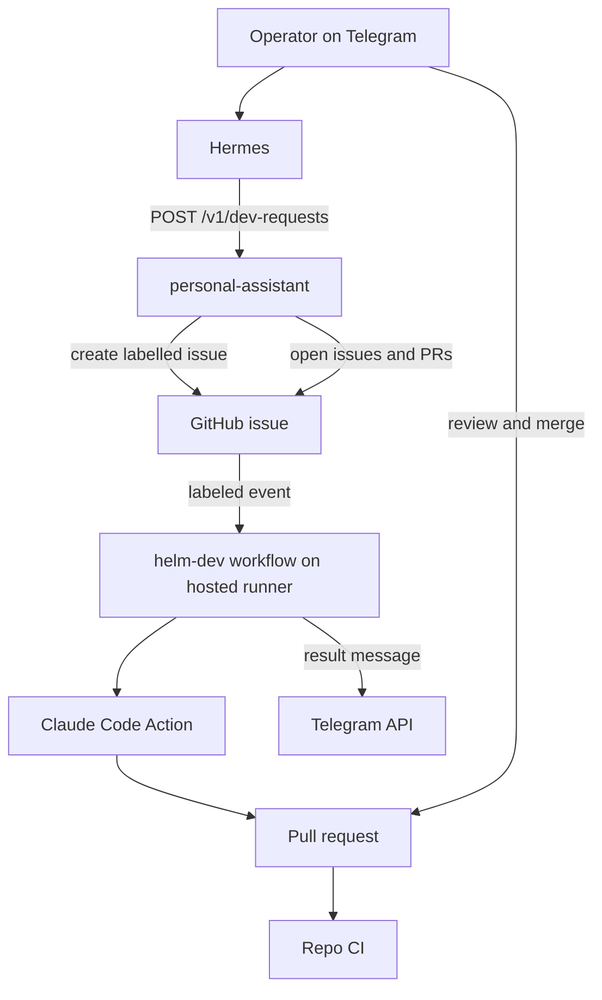

# Hosted dev lane: GitHub issue → Claude Code Action → PR (design)

**Date:** 2026-11-14
**Status:** adopted in chat on 2026-11-14; awaiting spec file review before any implementation plan
**Relation to other specs:** supersedes [2026-11-13-unimatrix-dev-lane-design.md](2026-11-13-unimatrix-dev-lane-design.md), which was never implemented.

## Goal

Same outcome as the Unimatrix dev lane, with far less to build and operate:

1. Operator sends Hermes a Telegram message such as "in `xbonell/foo`, add retry to the weather client".
2. Helm opens a labelled GitHub issue in that repo.
3. A GitHub Actions workflow in the repo runs the Claude Code Action on the operator's Claude subscription and produces a PR.
4. The repo's own CI runs; the operator reviews and merges.
5. The workflow sends the PR link on Telegram, and the daily brief lists outstanding dev work.

## Why a second design

The Unimatrix design runs an unattended coding agent with full permissions on the Helm host. Most of that spec (egress proxy, two Unix users, `sudo` rules, reaper, bearer key, isolated work trees) exists only to contain that agent. A hosted runner is a throwaway machine, so none of it is needed. The leases, attempts and claim races in Unimatrix solve coordination between untrusted participants, which a single operator does not have.

What this gives up is stated under [Trade-offs](#trade-offs).

## Decisions

| Topic | Choice | Why |
|-------|--------|-----|
| Where the agent runs | **GitHub-hosted Actions runner** in the target repo | Ephemeral machine; no agent isolation to build in Helm |
| Coding agent | **`anthropics/claude-code-action@v1`** | Maintained by Anthropic; documented support for subscription auth |
| Agent credential | Repo secret **`CLAUDE_CODE_OAUTH_TOKEN`** from `claude setup-token` | Runs "use your Claude subscription instead of API billing"; available on Pro, Max, Team and Enterprise |
| Trigger | Issue **labelled `helm-dev`** | Label gating is a documented trigger; issues without the label are untouched |
| Who creates the issue | `personal-assistant`, with the **operator's fine-grained PAT** | The action rejects bot actors and users without write access by default; an operator-owned token passes both checks with no extra configuration |
| Token placement | In `personal-assistant` only; **Hermes never holds it** | The model can ask for an issue but cannot reach GitHub directly or choose a repo outside the allowlist |
| Source of truth | **GitHub** issues and PRs; nothing mirrored into Paperclip | Unchanged from the previous spec: a Paperclip assignment or comment wakes the Hermes agent |
| Review gate | **Branch protection** on the default branch: PR required, CI must pass | Replaces Unimatrix validation modes with what GitHub already enforces |
| Notifications | Final **workflow step** calls the Telegram API | The action has no completion webhook; a step with `if: always()` reports success and failure |
| Run bounds | Job `timeout-minutes: 30`, `--max-turns 50`, one run per repo at a time (`concurrency`) | Documented controls; no custom cap logic |
| Unimatrix | **Not used.** `xbonell/unimatrix` archived on 2026-11-14 | Its trust model is not needed for one operator |
| New services | **None.** One new module in `personal-assistant` | Same pattern as `gcal.py` |
| Model for Hermes and `model-router` | Operator's OpenAI key with `gpt-6-luna` | Unchanged from the previous spec |

## Architecture



Coupling rules (additions to `docs/architecture.md`):

- Only `personal-assistant` holds a GitHub token, and it can only open issues and read issues and PRs.
- Helm never runs a coding agent and never holds the Claude subscription token. The token lives only as a GitHub repo secret.
- Dev work is never mirrored into Paperclip issues.

## Changes in each target repo

One workflow file, `.github/workflows/helm-dev.yml`, copied from a template kept in Helm at `templates/helm-dev.yml`. The sketch below is composed from the action's documented inputs and has **not been run**; milestone 1 exists to prove it.

```yaml
name: helm-dev
on:
  issues:
    types: [labeled]

concurrency:
  group: helm-dev
  cancel-in-progress: false

jobs:
  implement:
    if: github.event.label.name == 'helm-dev'
    runs-on: ubuntu-latest
    timeout-minutes: 30
    permissions:
      contents: write
      pull-requests: write
      issues: write
      id-token: write
      actions: read
    steps:
      - uses: actions/checkout@v6
      - uses: anthropics/claude-code-action@v1
        with:
          claude_code_oauth_token: ${{ secrets.CLAUDE_CODE_OAUTH_TOKEN }}
          prompt: |
            Implement issue #${{ github.event.issue.number }} as described in its body.
            Run the project's tests. Commit to a new branch and open a pull request
            that references the issue. Comment the PR link on the issue.
          claude_args: "--max-turns 50"
      - name: Notify
        if: always()
        env:
          TELEGRAM_BOT_TOKEN: ${{ secrets.HELM_TELEGRAM_BOT_TOKEN }}
          TELEGRAM_CHAT_ID: ${{ secrets.HELM_TELEGRAM_CHAT_ID }}
          GH_TOKEN: ${{ github.token }}
        run: ./.github/helm-dev-notify.sh "${{ job.status }}" "${{ github.event.issue.number }}"
```

Notes on the workflow:

- **Auth.** No `github_token` input is passed, so the action authenticates as the Claude GitHub App. That is required for CI to run on the result: GitHub does not trigger workflows for commits made with the default `GITHUB_TOKEN`. The Claude GitHub App must be installed on the repo.
- **PR creation.** By default the action commits to a branch and returns a link to the PR creation page instead of opening the PR. The prompt asks for a PR explicitly. If that proves unreliable, the fallback is a deterministic step that opens the PR from the branch using an App token. Which one is used is settled in milestone 1.
- **Notify script.** `helm-dev-notify.sh` (also from the template) looks up the PR linked to the issue and sends one fixed-format message: PR link on success, workflow run link on failure. With the Telegram secrets unset it exits quietly.
- **Permission mode.** The action's default is auto mode, where a classifier reviews each action. That is kept. The docs describe it as "a review, not a boundary", which is acceptable on a throwaway runner whose only secrets are the Claude token and the Telegram token.

Per-repo setup, done once by the operator:

1. Install the Claude GitHub App on the repo.
2. Add the secrets `CLAUDE_CODE_OAUTH_TOKEN`, `HELM_TELEGRAM_BOT_TOKEN` and `HELM_TELEGRAM_CHAT_ID`.
3. Copy the workflow and the notify script from `templates/`.
4. Create the `helm-dev` label.
5. Protect the default branch: require a PR and passing CI.

`scripts/setup-dev-repo.sh <owner/name>` automates steps 3 to 5 with `gh`, and prints what is left for steps 1 and 2.

## Changes in Helm

### 1. `personal-assistant`: `github_dev.py`

New module and two endpoints, following the `gcal.py` pattern.

| Endpoint | Purpose |
|----------|---------|
| `POST /v1/dev-requests` | Open a labelled issue in an allowlisted repo |
| `GET /v1/dev-status` | Outstanding dev work across allowlisted repos |

`POST /v1/dev-requests` request and response:

```json
{ "repo": "xbonell/foo", "title": "Add retry to the weather client", "instructions": "Add retry with backoff to the weather client. Keep the change to that client and its tests." }
```

```json
{ "repo": "xbonell/foo", "issue": 41, "url": "https://github.com/xbonell/foo/issues/41" }
```

- `repo` must be in `DEV_REPOS`, otherwise `403`.
- The issue is created with the `helm-dev` label already applied. `title` and `instructions` are required and length-limited (`422` otherwise).
- GitHub failure → `502` with a short safe message and no token.
- Credentials missing → `503` with `"status": "unconfigured"`.

`GET /v1/dev-status` response:

```json
{
  "status": "ok",
  "items": [
    { "repo": "xbonell/foo", "issue": 41, "title": "Add retry to the weather client", "state": "awaiting_review", "pull": 42 }
  ]
}
```

`state` is one of `running` (open issue, no PR yet), `awaiting_review` (open PR, checks passing or absent), `checks_failing` (open PR, a check failing) and `failed` (latest `helm-dev` workflow run for the issue failed, no PR). Merged and closed work is not listed.

Status rules match the calendar: credentials missing → `status: "unconfigured"` with an empty list; GitHub failure → `status: "error"` plus a short safe `error` string.

### 2. Planner (Hermes)

A Hermes skill, seeded by `scripts/bootstrap.sh`, that:

1. Recognises a development request and extracts `repo`, a short `title` and the `instructions`.
2. Asks one clarifying question if the repo is missing or not allowlisted.
3. Calls `POST http://personal-assistant:8083/v1/dev-requests` and replies with the issue link.

The skill does not call Decider.

### 3. Daily brief

- `generate_daily_brief` adds `sections.dev` and `sections.dev_status` from the same code path as `GET /v1/dev-status`.
- Brief generation must not fail because GitHub is unreachable.
- The Hermes routine description gains a "Dev" block listing items in `awaiting_review`, `checks_failing` and `failed`. Mocked `priorities` stay until a separate spec replaces them.

### 4. Config

| Variable | Service | Purpose |
|----------|---------|---------|
| `GITHUB_DEV_TOKEN` | personal-assistant | Operator's fine-grained PAT, limited to the allowlisted repos, with Issues read/write, Pull requests read, Actions read, Metadata read |
| `DEV_REPOS` | personal-assistant | Comma-separated `owner/name` allowlist |
| `DEV_LABEL` | personal-assistant | Trigger label, default `helm-dev` |

`.env.example` documents the names only. `scripts/healthcheck.sh` is unchanged (no new service); a new `scripts/smoke-dev-lane.sh` calls `GET /v1/dev-status` and checks each allowlisted repo has the workflow file and the label.

Hermes and `model-router` use the operator's OpenAI key as in the previous spec:

```text
MODEL_PROVIDER=openai_compatible
MODEL_BASE_URL=https://api.openai.com/v1
MODEL_API_KEY=<the OpenAI key>
MODEL_NAME=gpt-6-luna
```

## Security

- **No agent on the Helm host.** Repo code and model-chosen commands run on a GitHub-hosted runner that is destroyed after the job.
- **Narrow Helm-side token.** `GITHUB_DEV_TOKEN` cannot push code, merge, or touch repos outside the allowlist. The worst a compromised `personal-assistant` can do with it is open issues that start agent runs in allowlisted repos.
- **Who can start a run.** The action only runs for actors with write access and rejects bots unless listed in `allowed_bots`, which is left empty. On the operator's private repos that means the operator alone.
- **Unauthenticated endpoint.** `POST /v1/dev-requests` has no auth, like the rest of `personal-assistant`. It is reachable from other containers on the `helm` network and from the host's loopback. Any of them could open an issue in an allowlisted repo. That is accepted: every service on that network is already trusted, and the result is still a PR the operator must review.
- **Secrets on the runner.** The job sees the Claude subscription token and the Telegram token. A prompt-injected agent could try to send them out; the runner has open internet access. Issue text comes only from the operator, which keeps this risk low, but repo contents and dependencies are read by the agent too. This is the accepted residual risk, and the reason the spec applies only to the operator's own private repos.
- **Nothing merges unreviewed.** Branch protection requires a PR and passing CI, and the operator merges by hand.
- **Subscription terms.** The action with a subscription token is a documented configuration. The token is "tied to the subscription of the person who ran `claude setup-token`", so it must not be shared with other people's repos.

## Trade-offs

What this design gives up compared with the Unimatrix dev lane:

- **Self-hosting.** Helm's stated priority is "self-hosted > managed". Here the coding agent runs on GitHub's infrastructure and depends on GitHub Actions and Anthropic's action staying available and compatible.
- **Actions minutes.** Each run consumes GitHub Actions minutes, which are metered on private repos.
- **Usage controls.** There is no daily cap and no usage-limit pause. A run that hits a subscription limit fails, the workflow reports it on Telegram, and the operator re-applies the label later.
- **Adapter choice.** The agent is Claude Code. Another agent means another workflow.
- **Per-repo setup.** Each repo needs the workflow, secrets, label and App installed, instead of one entry in a Helm config file.
- **Formal validation.** No immutable work definition or recorded validation outcome; the PR and its checks are the record.

## Alternatives considered

| Option | Why not |
|--------|---------|
| Unimatrix dev lane (previous spec) | Self-hosted by design, but needs five milestones across two repos and a large isolation design for one operator |
| Claude Code cloud scheduled tasks, fired through their API | Simplest trigger (one HTTP call from Helm, no workflow file), but the feature is in research preview, its endpoint ships under an experimental beta header, opening the PR is not documented as automatic, and there is no completion notification |
| GitHub Copilot coding agent, Codex cloud | Comparable flow, but neither runs on the Claude subscription the operator already has |

## Out of scope

- Any change to `xbonell/unimatrix`.
- Running a coding agent inside the Helm stack.
- Automatic merging.
- Splitting one request into several issues.
- Replacing the mocked priorities, fitness and news sections.

## Milestones

| # | Deliverable | Done when |
|---|-------------|-----------|
| 1 | Workflow template, notify script and `scripts/setup-dev-repo.sh`; no Helm service changes | Hand-labelling an issue in a test repo ends in an open PR with CI running on it and a Telegram message with the PR link |
| 2 | `github_dev.py`, the two endpoints, config, smoke script, Hermes planner skill | A Telegram message produces an issue link reply, then a PR link message |
| 3 | `sections.dev` in the daily brief | Brief lists a PR awaiting review; brief still succeeds with GitHub unreachable |

Milestone 1 touches no Helm code and can be thrown away cheaply. If it fails on PR creation or CI triggering, the decision between the two designs is revisited before anything else is built.

## Remaining checks

All of these are settled in milestone 1 unless noted.

1. **PR creation.** Whether the prompt reliably makes the action open the PR in automation mode, or the deterministic fallback step is needed.
2. **CI on the PR.** Confirm that a PR created under the Claude GitHub App identity triggers the repo's CI workflows.
3. **Label at creation.** Confirm that an issue created with the label already applied fires the `labeled` event. If it does not, `personal-assistant` adds the label in a second call.
4. **PAT-authored events.** Confirm that an issue opened with the operator's fine-grained PAT passes the action's actor checks.
5. **Run failure on usage limit.** See how the action reports a subscription usage limit, so the notify script can say so plainly.
6. **Actions minutes.** Check the operator's GitHub plan allowance against an expected 10 to 30 minutes per run.
7. **`gpt-6-luna` as planner.** Test on a handful of real requests in milestone 2.

Facts about the action and about cloud scheduled tasks in this spec come from Anthropic's documentation as read on 2026-11-14.
